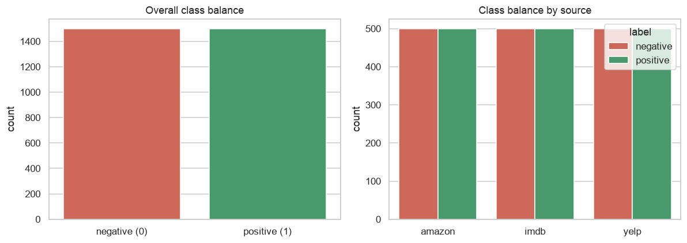
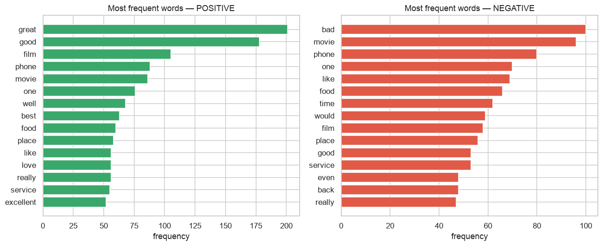
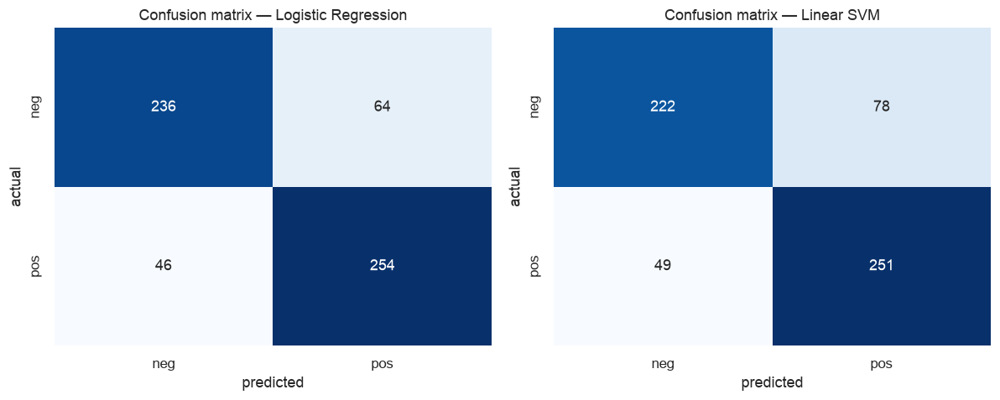
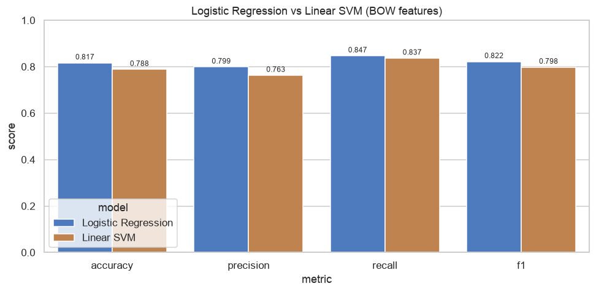

# Lab 01: Machine Learning

## Laboratory Session

Lab 01, Sentiment Analysis Using Traditional Machine Learning. This session covers classical NLP: text preprocessing, Bag of Words features, and linear classifiers, before any neural networks are introduced.

## Objective

The purpose of this activity was to build a sentiment classifier the classical way, so I could understand why later approaches such as transformers exist. Everything here is traditional machine learning: clean the text, turn it into Bag of Words count vectors, and train linear models. The dataset is the UCI Sentiment Labelled Sentences collection, which is 3,000 short review sentences pulled evenly from Amazon, IMDb, and Yelp, each labelled positive (1) or negative (0).

## Tasks and Implementation

I worked through the full pipeline in [`notebook/sentiment_analysis.ipynb`](notebook/sentiment_analysis.ipynb):

1. **Downloaded the data programmatically** from the UCI archive, unzipped the three source files in memory, and combined them into one DataFrame of 3,000 rows. The classes came out perfectly balanced (1,500 positive, 1,500 negative).
2. **Preprocessed** each sentence, lowercasing, stripping punctuation, digits and symbols with a regex, and collapsing whitespace, into a `clean_text` column while keeping the original for before and after comparison.

   ```python
   def clean_text(text: str) -> str:
       text = text.lower()                       # lowercase
       text = re.sub(r"[^a-z\s]", " ", text)     # remove punctuation / digits / symbols
       text = re.sub(r"\s+", " ", text).strip()  # collapse whitespace
       return text
   ```
3. **Explored** the data, sampling positive and negative reviews and plotting the most frequent words per class with NLTK stop words removed.
4. **Split** 80/20 with stratification (2,400 train, 600 test).
5. **Built Bag of Words features** with `CountVectorizer`, fitted on the training set only (`min_df=2`), giving a 1,878 term vocabulary. Fitting on the training set only avoids leaking test vocabulary into training.
6. **Trained Logistic Regression and Linear SVM** on the same features so the comparison is fair.
7. **Evaluated** both with Accuracy, Precision, Recall, and F1, plus confusion matrices, and added a TF-IDF comparison.
8. **Tested on new, hand written sentences** the models had never seen.

One detail I was careful about: a solvable but easy to miss environment issue. The UCI download first failed with a certificate error on the newer Python build, so I pointed SSL at the `certifi` CA bundle rather than disabling verification, which kept the download secure.

## Results and Evidence

All numbers below are the real captured values from the executed notebook (test set of 600 sentences).

Bag of Words features:

| Model | Accuracy | Precision | Recall | F1 |
|-------|:--------:|:---------:|:------:|:--:|
| Logistic Regression | 0.817 | 0.799 | 0.847 | 0.822 |
| Linear SVM | 0.788 | 0.763 | 0.837 | 0.798 |

Bag of Words vs TF-IDF (Accuracy / F1):

| Model | BOW | TF-IDF |
|-------|:---:|:------:|
| Logistic Regression | 0.817 / 0.822 | 0.833 / 0.838 |
| Linear SVM | 0.788 / 0.798 | 0.822 / 0.828 |

Class balance and word frequencies:




Confusion matrices and model comparison:




On fresh sentences the models behaved sensibly: "This product is absolutely fantastic, I love it!" scored 0.979 positive, and "Worst purchase I have ever made, totally useless." scored 0.033. The instructive miss was "It works fine, nothing special but does the job.", which was called positive with 0.965 confidence because the word "works" is a strong positive cue and Bag of Words has no notion of "nothing special" dampening it.

## Observations

- **Bag of Words works well but is blind to word order.** "not good" and "good" share the token "good". It still reaches around 80 percent because individual words carry most of the sentiment signal, but that lost context is exactly what sequence models later recover.
- **TF-IDF beat raw counts** by roughly 1.5 F1 points on both models, because it down weights words that appear in almost every review and lets the sharper words speak.
- **Metrics tell different stories.** Logistic Regression had higher recall (0.847) than precision (0.799), so it leans toward calling things positive. On balanced, equally costly classes I would report F1 as the headline; if false positives were expensive I would care more about precision.
- The main challenge was the certificate error on download, which I fixed cleanly rather than faking data.

## Learning Outcomes

- Built a complete traditional NLP pipeline end to end, from raw text to evaluated predictions.
- Learned the practical difference between Bag of Words and TF-IDF and when each helps.
- Learned to read Accuracy, Precision, Recall, and F1 as a set rather than trusting accuracy alone.
- Reinforced good practice: fit the vectoriser on training data only, and never fabricate data when a download fails.
