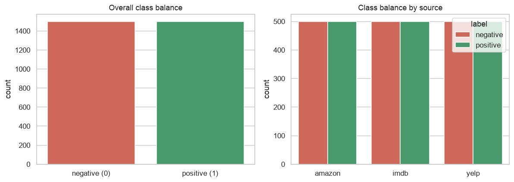
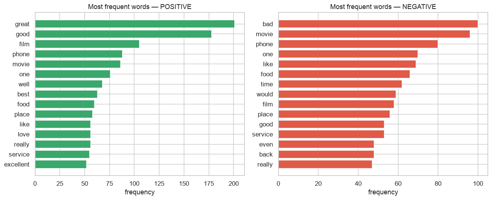
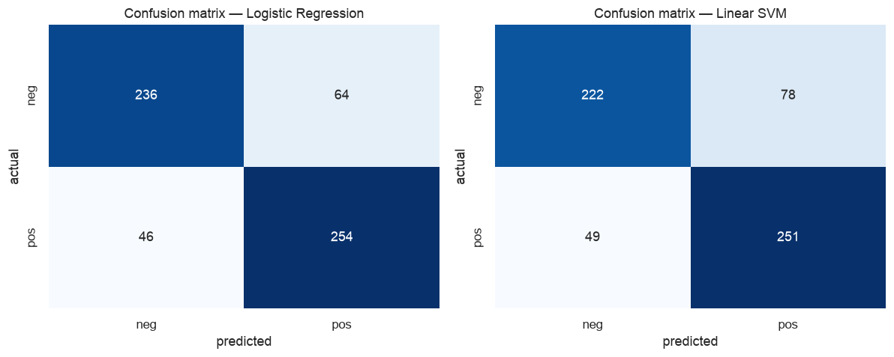
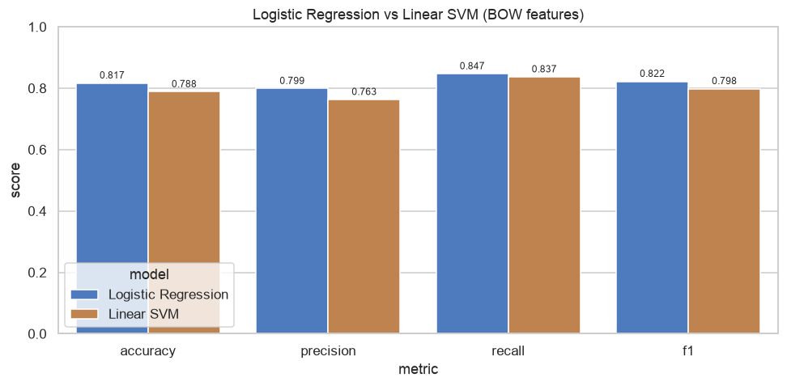

# Lab 1 Review — Sentiment Analysis Using Traditional Machine Learning

## What the lab was about

The goal was to build a sentiment classifier the "classical" way — before transformers and large
language models — so I could feel *why* those later approaches exist. Everything here is traditional
NLP: clean the text, turn it into Bag-of-Words count vectors, and train linear classifiers. The
dataset is the UCI *Sentiment Labelled Sentences* collection: 3,000 short review sentences pulled
evenly from Amazon, IMDb, and Yelp, each labelled positive (1) or negative (0).

## What I built and how

I worked through the full pipeline in
[`sentiment_analysis.ipynb`](sentiment_analysis.ipynb):

1. **Downloaded the data programmatically** from the UCI archive, unzipped the three source files in
   memory, and combined them into one DataFrame of 3,000 rows with a `source` column. The classes
   came out perfectly balanced (1,500 / 1,500).
2. **Preprocessed** each sentence — lowercased, stripped punctuation/digits/symbols with a regex,
   collapsed whitespace — into a `clean_text` column, keeping the original alongside so I could show
   before/after.
3. **Explored** the data: sampled positive vs negative reviews, and plotted the most frequent words
   per class (stop-words removed with NLTK). The split is intuitive — *great, love, excellent,
   recommend, works* dominate the positive class, while *bad, worst, waste, money, disappointed, poor*
   dominate the negative one.
4. **Split** 80/20 with stratification (2,400 train / 600 test).
5. **Built BOW features** with `CountVectorizer`, fitted on the training set only (`min_df=2`),
   giving a 1,878-term vocabulary.
6. **Trained Logistic Regression and Linear SVM** on the same features so the comparison is fair.
7. **Evaluated** both with Accuracy, Precision, Recall, and F1, plus confusion matrices.
8. **Tested on new, hand-written sentences** the models had never seen.

A deliberate detail: I fit the vectoriser **only on training data**. Fitting it on everything would
leak test vocabulary into training and inflate the scores — a subtle but real mistake I wanted to
avoid.

## Key concepts I learned

- **Bag-of-Words, and its blind spot.** BOW throws away word order entirely — "not good" and "good"
  share the word *good*. It still works surprisingly well for sentiment because individual words
  carry most of the signal, but that lost context is exactly what sequence models later recover.
- **BOW vs TF-IDF — and why TF-IDF won here.** BOW uses raw counts, so common-but-uninformative
  words get as much weight as rare, discriminative ones. TF-IDF down-weights words that appear in
  nearly every review, letting the sharper words speak. When I swapped BOW for TF-IDF, both models
  improved by roughly a point and a half of F1 (LogReg 0.822 → 0.838), which matches the theory.
- **Metric trade-offs.** Accuracy alone hides behaviour. Logistic Regression had **higher recall
  (0.847) than precision (0.799)** on the positive class — it leans toward *calling things positive*,
  so it catches most positives but produces more false positives. On balanced, equally-costly classes
  I'd pick F1 as the headline; if false positives were expensive I'd care more about precision.
- **Linear models + sparse text features are a strong, cheap baseline.** Two simple linear
  classifiers reached ~80% on raw text in seconds of training — a useful reminder that not every NLP
  problem needs a neural network.

## Results

All metrics below are the **real captured numbers** from the executed notebook (test set = 600
sentences).

**Bag-of-Words features:**

| Model | Accuracy | Precision | Recall | F1 |
|-------|:--------:|:---------:|:------:|:--:|
| **Logistic Regression** | **0.817** | 0.799 | 0.847 | **0.822** |
| Linear SVM | 0.788 | 0.763 | 0.837 | 0.798 |

**BOW vs TF-IDF (Accuracy / F1):**

| Model | BOW | TF-IDF |
|-------|:---:|:------:|
| Logistic Regression | 0.817 / 0.822 | **0.833 / 0.838** |
| Linear SVM | 0.788 / 0.798 | 0.822 / 0.828 |

Logistic Regression on BOW was the best of the BOW pair; TF-IDF lifted both models by ~1.5 F1 points.

**Class balance & word frequencies**

**Confusion matrices and model comparison**

**Generalisation to new sentences** — the models handled clear cases confidently:

| Sentence | LogReg | P(positive) | Linear SVM |
|----------|--------|:-----------:|------------|
| "This product is absolutely fantastic, I love it!" | POSITIVE | 0.979 | POSITIVE |
| "Worst purchase I have ever made, totally useless." | negative | 0.033 | negative |
| "The food was delicious and the service was great." | POSITIVE | 0.986 | POSITIVE |
| "I would not recommend this to anyone, very disappointing." | negative | 0.027 | negative |
| "It works fine, nothing special but does the job." | POSITIVE | 0.965 | POSITIVE |

That last row is the most instructive miss: a genuinely *neutral* sentence is called POSITIVE with
0.965 confidence, purely because the word *works* is a strong positive cue and BOW has no notion of
"nothing special" dampening it. It's a concrete example of what a context-free representation can't do.

## Challenges and what I'd improve

- **Environment hiccup.** The download first failed with `CERTIFICATE_VERIFY_FAILED` because this
  Python build had no system CA bundle. I fixed it by pointing SSL at `certifi`'s bundle rather than
  disabling verification — keeping the download secure. (This is noted in the notebook.)
- **No handling of negation.** The neutral-sentence miss above is the clearest weakness. I'd try
  bigram features (`ngram_range=(1,2)`) so "not good" becomes its own token, which usually helps
  sentiment models meaningfully.
- **What I'd do next.** Tune regularisation with cross-validation, add the bigrams above, and look at
  the largest model coefficients to see which words drive predictions — a cheap way to sanity-check
  that the model learned sentiment rather than dataset quirks.
