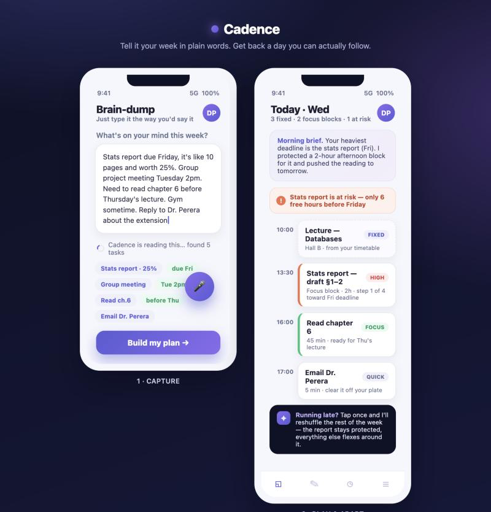

# Lab 2 Review — AI in Everyday Challenges

**Scenario: Group 5 — The Busy Student**

## What the lab was about

Unlike the other two labs, this one wasn't a coding exercise. The point was to practise using an LLM
as a *development partner* — to take a real, everyday student problem and work with the model the way
you'd work with a design collaborator: framing the problem, generating ideas, cutting the weak ones,
and ending up with a concrete product concept and a visual prototype. My assigned scenario was the
**Busy Student**: someone juggling lectures, assignments, group projects, and deadlines, where
important tasks get forgotten or left to the last minute.

## What I built and how

I produced two deliverables:

- **[`product-concept.md`](product-concept.md)** — the full concept for **Cadence**, a mobile time
  companion built around a *Brain-dump → Plan → Adapt* loop: problem framing, product name,
  concept, six key features, the target user (with a persona), and a section on exactly how an LLM
  powers each part.
- **[`mockup/cadence-mockup.html`](mockup/cadence-mockup.html)** — a single self-contained HTML
  mock-up (inline CSS, no external dependencies, opens straight in a browser) of the two main
  screens, with a captured screenshot saved at
  [`mockup/cadence-mockup.png`](mockup/cadence-mockup.png).

My process was deliberately to *drive the LLM rather than let it drive me*. I started by making it
argue with my problem framing until I had three concrete failure points (capture friction, no sense
of time cost, plans that break and never recover). I then had it brainstorm a wide set of features
and names, and I cut aggressively — an early "social study leaderboard" idea got dropped because it
solved a motivation problem, not the time-management problem in the brief. The final feature set and
the product decisions were mine; the LLM made the exploration faster and the microcopy sharper.

## Key concepts I learned

- **An LLM is most valuable where rules are brittle.** The genuinely LLM-shaped parts of Cadence are
  the ones you can't easily hard-code: turning a messy sentence into structured tasks, reasoning
  over constraints to build a schedule, and explaining a re-plan in plain language. Spotting *which*
  parts of a product actually need a model — versus which should stay deterministic — was the main
  design skill this lab taught me.
- **Keep the LLM out of the source of truth.** The most useful decision in the concept was drawing a
  line: the LLM *proposes* a plan, but the timetable, the done/not-done state, and the reminder
  timing live in ordinary structured storage and deterministic logic. That's what stops the product
  from hallucinating a deadline — a real reliability concern for anything built on an LLM.
- **Prompting as a design conversation.** Using the model to pressure-test ideas (not just generate
  them) produced a much tighter concept than asking it to "design an app" would have. The quality of
  the output tracked the quality of the constraints I gave it.

## Challenges and what I'd improve

- **Scoping ambition.** My first draft had far too many features. The useful discipline was asking,
  for each one, "does this solve *the brief's* problem?" and cutting anything that didn't.
- **Making the mock-up feel real without a backend.** I wanted the prototype to communicate the
  *reasoning* the LLM does, so I showed concrete artefacts of it — parsed task chips on the capture
  screen, an "at risk" flag, and a morning brief that explains a trade-off — rather than generic
  placeholder UI.
- **What I'd do next.** With more time I'd build a working slice: wire the brain-dump box to an
  actual LLM call that returns structured JSON tasks, then render them. That would let me test the
  thing that makes or breaks the product — whether the parsing and scheduling are good enough that a
  student would trust the plan.
