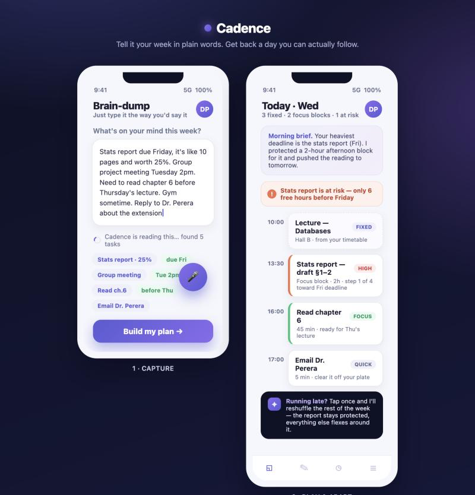

# Lab 02: LLM in Everyday Life

## Laboratory Session

Lab 02, AI in Everyday Challenges. This session uses an LLM as a product development partner to design a product that solves a real, everyday student problem. My assigned scenario was Group 5, the Busy Student.

## Objective

Unlike the other labs, this one was not a coding exercise. The point was to practise using an LLM as a development collaborator: framing a problem, generating ideas, cutting the weak ones, and ending up with a concrete product concept and a visual prototype. My scenario was the Busy Student, someone juggling lectures, assignments, group projects, and deadlines, where important tasks get forgotten or left to the last minute.

## Tasks and Implementation

I produced two deliverables plus the required group activity write-ups:

- **[`product-concept.md`](product-concept.md)**, the full concept for Cadence, a mobile time companion built around a Brain-dump, Plan, Adapt loop: problem framing, product name, six key features, the target user with a persona, and a section on exactly how an LLM powers each part.
- **[`screenshots/cadence-mockup.html`](screenshots/cadence-mockup.html)**, a single self-contained HTML mock-up (inline CSS, no dependencies) of the two main screens, with a captured screenshot at [`screenshots/cadence-mockup.png`](screenshots/cadence-mockup.png).
- **[`group-activity/`](group-activity/)**, the group members placeholder, the activity outcomes, and the discussion summary.

My process was to drive the LLM rather than let it drive me. I started by making it pressure-test my problem framing until I had three concrete failure points (capture friction, no sense of time cost, and plans that break and never recover). I then had it brainstorm features and names, and I cut aggressively. An early "social study leaderboard" idea was dropped because it solved a motivation problem, not the time-management problem in the brief. The final feature set and the product decisions were mine; the LLM made the exploration faster and the microcopy sharper.

## Results and Evidence

The main screen mock-up shows the two screens at the heart of the core loop: the brain-dump capture screen and the generated "Today" plan with prioritisation, an at-risk flag, and a context nudge.

## Observations

- **An LLM is most valuable where rules are brittle.** The genuinely LLM-shaped parts of Cadence are the ones you cannot easily hard-code: turning a messy sentence into structured tasks, reasoning over constraints to build a schedule, and explaining a re-plan in plain language.
- **Keep the LLM out of the source of truth.** The most useful design decision was drawing a line: the LLM proposes a plan, but the timetable, the done state, and the reminder timing live in ordinary deterministic logic. That is what stops the product hallucinating a deadline.
- **Prompting is a design conversation.** Using the model to pressure-test ideas, not just generate them, produced a much tighter concept than asking it to "design an app" would have.
- The main challenge was scope. My first draft had far too many features, and the useful discipline was asking, for each one, whether it solved the brief's problem.

## Learning Outcomes

- Learned to use an LLM as a design collaborator, steering it with constraints rather than accepting its first output.
- Learned to decide which parts of a product should use a model and which should stay deterministic.
- Practised turning a vague everyday problem into a concrete product concept with a named user and clear features.
- Built a self-contained visual prototype that communicates the product's reasoning, not just generic UI.
