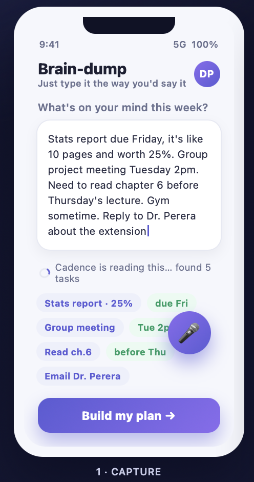
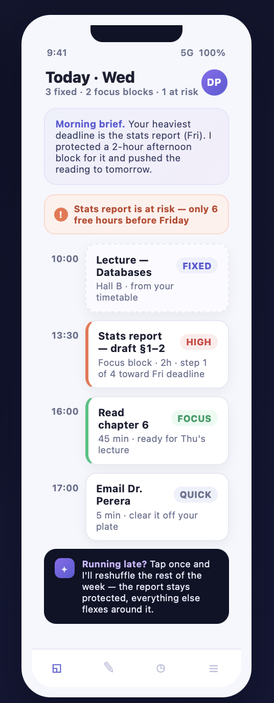

# Activity Outcomes

**Scenario:** Group 5, the Busy Student.

This file records what our group produced in the Lab 2 activity. Using an LLM as our development partner, we designed a product that helps busy students organise and manage their time, and we delivered a product concept, a name, key features, a target user, and a visual prototype.

## The product we designed: Cadence

We designed **Cadence**, a mobile app that uses an LLM to turn a messy brain-dump into a protected daily plan. It works in three moves:

1. **Capture.** The student types or speaks everything on their mind in plain language, the way they would say it. The LLM reads it and extracts structured tasks with deadlines, weights, and time estimates.
2. **Plan.** Cadence generates the day. It writes a short morning brief, pulls fixed items from the timetable, blocks focus time for heavy work, flags what is at risk, and labels each block FIXED, FOCUS, HIGH, or QUICK.
3. **Adapt.** When the student falls behind, one tap reshuffles the rest of the week. High-stakes deadlines stay protected and everything else flexes around them.

## Name

**Cadence.** The name reflects the goal: not a rigid timetable, but a sustainable rhythm a student can actually keep. Our tagline is "Just type it the way you'd say it."

## Key features

- Natural-language capture, one box, no forms.
- Voice input, so capture works when typing is too slow.
- LLM task extraction, pulling deadlines, weights, and time estimates from plain words.
- Auto daily plan, a ready-made, time-blocked day.
- At-risk detection, flagging tight deadlines before they slip.
- Protected focus blocks, so heavy work gets real, guarded time.
- One-tap weekly reshuffle, rebuilding the week in a second.
- Morning brief, a plain-language plan for the day.

## Target user

**Primary:** full-time university students with heavy, deadline-driven weeks, who miss deadlines from poor visibility and under-estimation, not from not caring. **Secondary:** any student who struggles to prioritise, including first-years building study habits and part-time or postgraduate students juggling study with work.

## How the LLM powers it

The LLM is the engine inside the product (parsing the brain-dump, prioritising, writing the morning brief, and rescheduling) and it was also our development partner while we designed Cadence. We kept the timetable, reminders, and task state in deterministic logic so the plan stays reliable, with the model proposing rather than holding the source of truth.

## Deliverables produced

- **Pitch deck:** [`Cadence-Pitch-Deck.pptx`](Cadence-Pitch-Deck.pptx), an 11-slide deck covering the problem, the solution, how it works, the features, the prototype, and the team.
- **Visual prototype, screen 1 (Capture):** [`screenshots/cadence-01-capture.png`](screenshots/cadence-01-capture.png), the brain-dump screen where plain text becomes structured task chips.

  

- **Visual prototype, screen 2 (daily plan):** [`screenshots/cadence-02-daily-plan.png`](screenshots/cadence-02-daily-plan.png), the generated day with the morning brief, the at-risk flag, labelled blocks, and the one-tap reschedule.

  

The full written concept is in [`../product-concept.md`](../product-concept.md), and the team and contributions are in [`group-members.md`](group-members.md).
