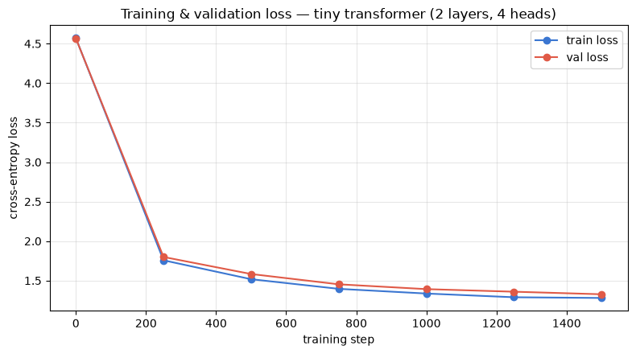
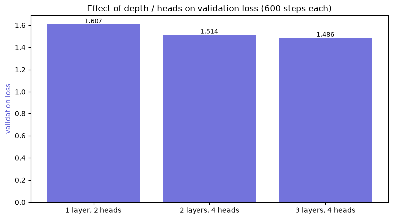

# Lab 03: Tiny Transformer

## Laboratory Session

Lab 03, Developing a Tiny Transformer Language Model. This session builds a small GPT style Transformer from scratch in PyTorch and trains it for next token prediction.

## Objective

The goal was to build a Transformer language model from scratch, not import one, and train it for next character prediction, so that every piece of the architecture (attention, masking, positional embeddings, residuals, layer norm) is something I wrote and understand. The data is the TinyStories dataset, a corpus of very simple children's stories, small and clean enough that a tiny model can learn from it on a CPU. The explicit constraint was that it had to run end to end on CPU in a few minutes, so quality of generation was secondary to getting the whole pipeline working.

## Tasks and Implementation

In [`notebooks/tiny_transformer.ipynb`](notebooks/tiny_transformer.ipynb) I followed the full lab sequence:

1. **Streamed** 2,000 stories from Hugging Face (streaming, so the full dataset is never downloaded) and explored their length distribution.
2. **Tokenised at the character level**, so the vocabulary is just the 80 unique characters in the corpus (1.7M characters total).
3. **Prepared next token training data**: encoded the corpus into one long tensor, held out the last 10 percent for validation, and wrote a `get_batch` that returns a chunk `x` and the same chunk shifted by one as the target `y`.
4. **Built the architecture from scratch** in PyTorch: a `Head` of scaled, causally masked self attention, `MultiHeadAttention`, a `FeedForward` MLP, a `Block` combining them with residual connections and pre layer norm, and a `TinyTransformer` that adds token and positional embeddings and a final linear head.
5. **Trained** the main model (2 layers, 4 heads, d_model 128) for 1,500 steps with AdamW.
6. **Monitored** train and validation loss and plotted the curves.
7. **Evaluated** with validation loss and perplexity.
8. **Generated** text from prompts including "Once upon a time".
9. **Experimented** by varying the number of layers and heads.
10. **Saved** the model weights, config, and tokenizer to [`notebooks/tiny_transformer.pt`](notebooks/tiny_transformer.pt).

## Results and Evidence

All numbers below are the real captured values from the executed notebook (CPU only).

Main model (2 layers, 4 heads, d_model 128):

| Metric | Value |
|--------|-------|
| Parameters | 424,784 |
| Training time | 28.3 s (1,500 steps, CPU) |
| Final train loss | 1.266 |
| Final validation loss | 1.325 |
| Validation perplexity | 3.76 (vs about 80 for random guessing) |

The loss curve drops steeply then flattens, with train and validation tracking each other closely, so the model is learning real structure rather than overfitting:

Experiment, effect of depth and heads (each trained for 600 steps so the comparison is fair):

| Config | Params | Val loss | Perplexity | Time |
|--------|:------:|:--------:|:----------:|:----:|
| 1 layer, 2 heads | 226,896 | 1.607 | 4.99 | 4.6 s |
| 2 layers, 4 heads | 424,784 | 1.514 | 4.55 | 11.1 s |
| 3 layers, 4 heads | 622,672 | 1.486 | 4.42 | 16.3 s |

Sample generation from "Once upon a time" (full set in [`results/generated_samples.txt`](results/generated_samples.txt)):

> "Once upon a time, there was a brong on the too same. It have an all that the brove. She was decided to put it a to hat bad the runny cus with gight it."

It is not fluent, but for a 425k parameter character model trained for 28 seconds it has clearly learned real English structure: capitalisation after full stops, spacing, plausible word shapes, and the TinyStories register.

## Observations

- **Self attention is just weighted lookups.** Writing `wei = q @ k.T` then `wei @ v` by hand made it clear that attention is each position building a query, matching it against every other position's key, and taking a weighted average of their values.
- **The `1/sqrt(head_size)` scaling matters.** Without it the dot products grow with dimension, the softmax saturates, and gradients die.
- **Causal masking is what makes it a language model.** Filling the upper triangle with negative infinity before the softmax stops each position seeing the future.
- **More depth lowered the loss every time, with diminishing returns and rising cost.** This is a small, honest version of the compute versus quality trade off behind scaling real models.
- The main challenge was keeping it genuinely fast. The whole notebook, main training plus three experiment runs, finishes in about a minute on CPU.

## Learning Outcomes

- Implemented every core Transformer component from scratch and can explain what each one does and why.
- Understood perplexity as "how many characters the model is effectively choosing between", and watched it fall from about 80 to 3.76.
- Saw the depth versus cost trade off directly through the experiment table.
- Learned to size a deep learning task so it is reproducible on modest hardware.
