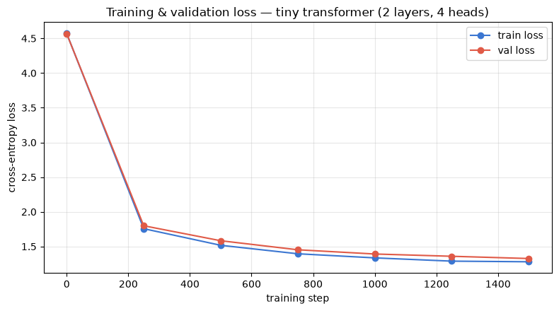
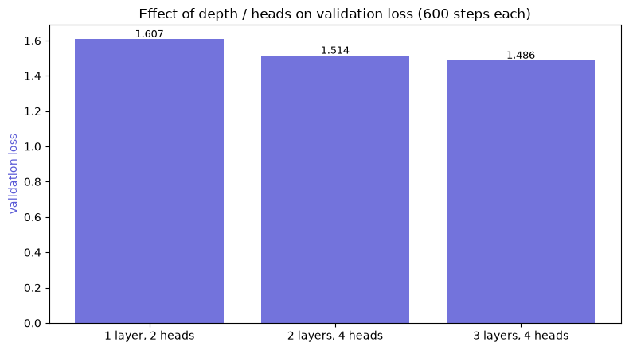

# Lab 3 Review — Developing a Tiny Transformer Language Model

## What the lab was about

The goal was to build a Transformer language model **from scratch** — not import one — and train it
for next-token prediction, so that every piece of the architecture (attention, masking, positional
embeddings, residuals, layer norm) is something I wrote and understand. The data is
[`roneneldan/TinyStories`](https://huggingface.co/datasets/roneneldan/TinyStories), a corpus of very
simple children's stories, which is small and clean enough that a tiny model can actually learn from
it on a CPU. The explicit constraint was that it had to **run end to end on CPU in a few minutes**,
so quality of generation was secondary to getting the whole pipeline working.

## What I built and how

In [`tiny_transformer.ipynb`](tiny_transformer.ipynb) I went through the full lab-sheet sequence:

1. **Streamed** 2,000 stories from Hugging Face (streaming, so I never download the full dataset) and
   explored their length distribution — most are 500–1,000 characters.
2. **Tokenised at the character level** — the vocabulary is just the 80 unique characters in the
   corpus (1.7M characters total). Simple, no external vocab file, tiny embedding table.
3. **Prepared next-token training data**: encoded the corpus into one long tensor, held out the last
   10% for validation, and wrote a `get_batch` that returns a chunk `x` and the same chunk shifted by
   one as the target `y`.
4. **Built the architecture from scratch** in PyTorch: a `Head` of scaled, causally-masked
   self-attention; `MultiHeadAttention`; a `FeedForward` MLP; a `Block` combining them with residual
   connections and pre-layer-norm; and a `TinyTransformer` that adds token + positional embeddings and
   a final linear head.
5. **Trained** the main model (2 layers, 4 heads, `d_model`=128) for 1,500 steps with AdamW.
6. **Monitored** train and validation loss and plotted the curves.
7. **Evaluated** with validation loss and **perplexity**.
8. **Generated** text from several prompts, including *"Once upon a time"*.
9. **Experimented** by varying the number of layers and heads.
10. **Saved** the model weights + config + tokenizer to a small checkpoint.

## Key concepts I learned

- **Self-attention is just weighted lookups.** Writing `wei = q @ k.T` and then
  `wei @ v` by hand made it click that attention is each position building a query, matching it
  against every other position's key, and taking a weighted average of their values.
- **Why the `1/√(head_size)` scaling exists.** Without it, the dot-products grow with dimension, the
  softmax saturates, and gradients die. It's a one-line detail that matters for training to start at
  all.
- **Causal masking is what makes it a language model.** Filling the upper triangle with `-inf` before
  the softmax stops each position from seeing the future, so the model is genuinely forced to
  *predict* the next character rather than copy it.
- **Positional embeddings restore order.** Attention alone is permutation-invariant — it has no idea
  which character came first — so the learned position embedding is what lets it model sequence.
- **Residual connections + layer norm make depth trainable.** This was the clearest lesson from the
  experiment below: stacking blocks only helps because the residual "highway" and normalisation keep
  gradients and activations well-behaved.
- **Perplexity as an intuition.** `perplexity = exp(loss)` is "how many characters the model is
  effectively choosing between at each step." Going from ~80 (random over the vocab) down to **3.76**
  is a concrete measure of how much structure the model learned.

## Results

All numbers below are the **real captured values** from the executed notebook (CPU only).

**Main model (2 layers, 4 heads, d_model=128):**

| Metric | Value |
|--------|-------|
| Parameters | 424,784 |
| Training time | **28.3 s** (1,500 steps, CPU) |
| Final train loss | 1.266 |
| Final validation loss | 1.325 |
| **Validation perplexity** | **3.76** (vs ~80 for random guessing) |

The loss curve drops steeply then flattens, with train and validation tracking each other closely —
so the model is learning real structure, not overfitting the subset:

**Experiment — effect of depth / heads** (each trained for 600 steps so the comparison is fair):

| Config | Params | Val loss | Perplexity | Time |
|--------|:------:|:--------:|:----------:|:----:|
| 1 layer, 2 heads | 226,896 | 1.607 | 4.99 | 4.6 s |
| 2 layers, 4 heads | 424,784 | 1.514 | 4.55 | 11.1 s |
| 3 layers, 4 heads | 622,672 | 1.486 | 4.42 | 16.3 s |

More depth lowers the loss every time, but with diminishing returns and a roughly linear rise in
training time — a small, honest version of the compute-vs-quality trade-off behind scaling real LLMs.

**Generated samples** (main model, `temperature=0.8`, prompt *"Once upon a time"*):

> *"Once upon a time, there was a brong on the too same. It have an all that the brove. She was decided to put it a to hat bad the runny cus with gight it. They plaine, the fast, he feer so their purpinner..."*

It's not fluent — but for a 425k-parameter character model trained for 28 seconds, it has clearly
learned real English structure: correct capitalisation after full stops, spacing, plausible word
shapes, the TinyStories register ("Once upon a time, there was a…", "She was decided to…"), and
mostly real words. The full set is in
[`outputs/generated_samples.txt`](outputs/generated_samples.txt). The saved model, reloaded from
disk, produces: *"Once upon a time there was a little girl sky. She said not out of on the dos"*.

## Challenges and what I'd improve

- **Keeping it genuinely fast.** The main lever was accepting a tiny model (block size 64, d_model
  128, 2 layers). The whole notebook — main training *plus* three experiment runs — finishes in about
  a minute on CPU, comfortably inside the "few minutes" budget.
- **Character-level is the quality ceiling.** The model spends capacity learning to spell. The single
  biggest quality improvement would be a **sub-word tokenizer** (e.g. BPE), so each step predicts a
  word-piece instead of a letter — fewer steps per word and immediately more coherent output.
- **What I'd do next.** Train longer with a learning-rate schedule (warmup + cosine decay), add the
  sub-word tokenizer above, and try weight-tying the embedding and output layers. I'd also wire up the
  optional Gradio chat window to make the saved model interactive.
