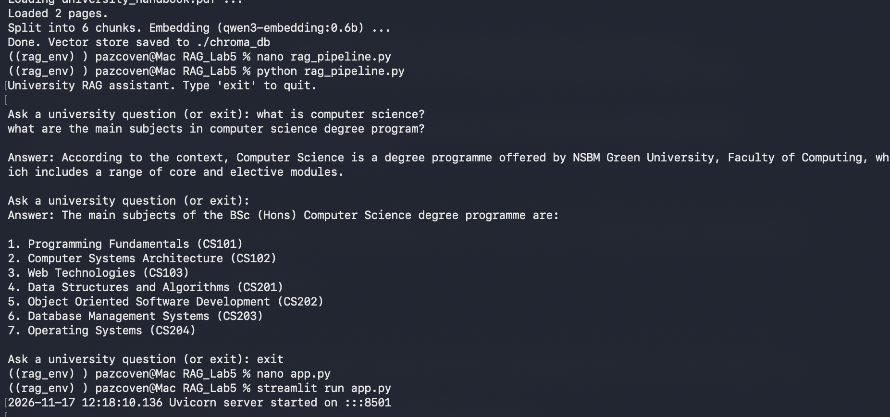
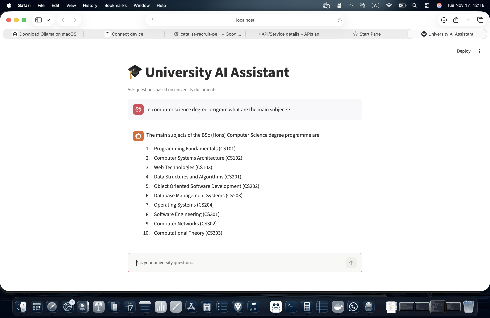
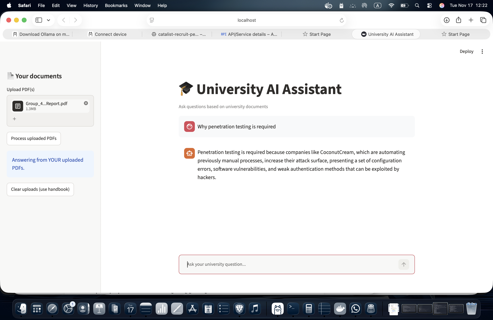
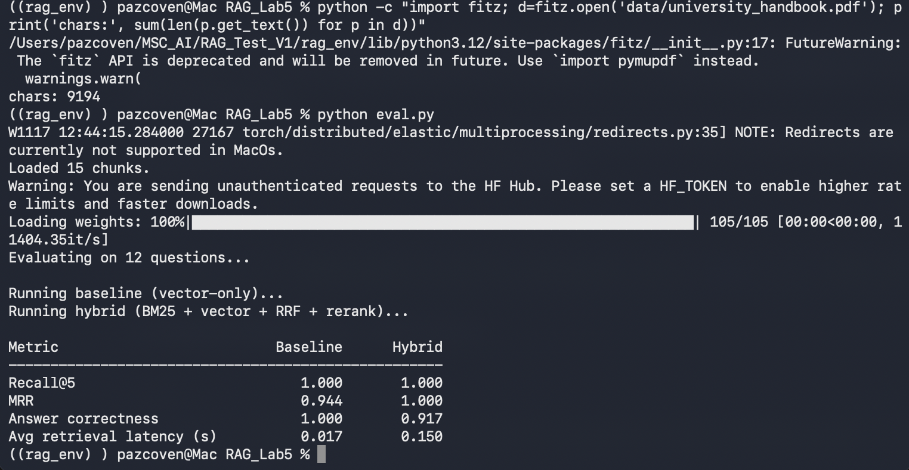
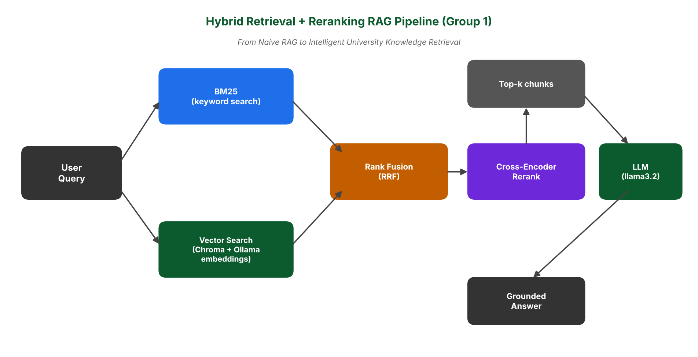

# Lab 05: RAG Pipeline

## Laboratory Session

Lab 05, RAG Architecture. This session builds a Retrieval-Augmented Generation (RAG) assistant over university PDF documents using LangChain, ChromaDB, Ollama, and Streamlit, and then extends it with an advanced hybrid retrieval architecture for the group activity.

## Objective

The purpose was to build a document-grounded question answering system: ingest university PDFs, embed them into a vector database, retrieve the most relevant chunks for a question, and have a local LLM answer using only that retrieved context. The lab task was to extend the base app so it reads multiple PDFs and lets users upload their own PDFs and get answers. The group activity (From Naive RAG to Intelligent University Knowledge Retrieval, Group 1) was to improve one limitation of the base system, for which I implemented hybrid retrieval and reranking.

The stack, all running locally:

- **LLM:** Llama 3.2 3B via Ollama
- **Embedding model:** Qwen3 Embedding 0.6B (`qwen3-embedding:0.6b`) via Ollama
- **Vector database:** ChromaDB
- **Framework and UI:** LangChain and Streamlit
- **Environment:** `rag_env` (Python 3.12)

## Tasks and Implementation

All source is in [`src/`](src/). The corpus is [`data/university_handbook.pdf`](data/university_handbook.pdf).

**1. Ingestion ([`src/ingest.py`](src/ingest.py)).** Loads every PDF in `data/` with PyMuPDF, splits with a recursive character splitter (800 chars, 120 overlap), embeds with `qwen3-embedding:0.6b`, and persists to a ChromaDB store.

```python
splitter = RecursiveCharacterTextSplitter(chunk_size=800, chunk_overlap=120)
chunks = splitter.split_documents(docs)
embeddings = OllamaEmbeddings(model="qwen3-embedding:0.6b")
Chroma.from_documents(chunks, embeddings, persist_directory=CHROMA_DIR)
```

**2. Terminal RAG ([`src/rag_pipeline.py`](src/rag_pipeline.py)).** A retrieve, augment, generate loop: top-k (k=4) similarity retrieval, a strict "answer only from the context" prompt, and `llama3.2:3b` for generation.

**3. Streamlit app and the lab task ([`src/app.py`](src/app.py)).** The University AI Assistant web UI. This is where I implemented the task: a sidebar PDF uploader that accepts multiple files, embeds them into a separate collection, and answers from the user's uploaded PDFs when present, falling back to the default handbook otherwise.

```python
uploaded = st.sidebar.file_uploader("Upload PDF(s)", type="pdf", accept_multiple_files=True)
# ... build a Chroma store from the uploads, then:
store = st.session_state.get("user_store", base_store)   # uploaded or default
retriever = store.as_retriever(search_kwargs={"k": 4})
```

**4. Group activity, hybrid retrieval and reranking ([`src/hybrid_pipeline.py`](src/hybrid_pipeline.py)).** The base system uses dense vector retrieval only, which under-weights exact academic terms such as module codes (CS102, DS202). My enhancement adds:

1. **BM25** keyword retrieval (`rank_bm25`) to catch exact terms.
2. **Dense vector retrieval** for meaning.
3. **Reciprocal Rank Fusion (RRF)** to merge the two ranked lists.
4. **Cross-encoder reranking** (`cross-encoder/ms-marco-MiniLM-L-6-v2`) to re-score the shortlist jointly with the query.

**5. Evaluation ([`src/eval.py`](src/eval.py)).** Compares the baseline (vector only) against the hybrid system on 12 labelled questions, measuring Recall@5, MRR, answer correctness, and retrieval latency. The architecture diagram is in [`screenshots/hybrid_rag_architecture.png`](screenshots/hybrid_rag_architecture.png) and the report notes are in [`REPORT_NOTES.md`](REPORT_NOTES.md).

### How to run

```bash
# Ollama must be running with the models pulled:
#   ollama pull llama3.2:3b
#   ollama pull qwen3-embedding:0.6b
python src/ingest.py          # build the Chroma store
python src/rag_pipeline.py    # terminal RAG
streamlit run src/app.py      # web UI with PDF upload
python src/hybrid_pipeline.py # hybrid retrieval (terminal)
python src/eval.py            # baseline vs hybrid metrics
```

## Results and Evidence

**Ingestion and terminal RAG.** `ingest.py` builds the store and `rag_pipeline.py` answers university questions from the handbook:



**Streamlit University AI Assistant** answering from the default handbook:



**The lab task, user PDF upload.** After uploading a PDF, the app answers from the user's own document (here a different uploaded report), which is the "upload your own PDFs and get answers" requirement:



**Group activity evaluation, baseline vs hybrid** (real output from `eval.py`, 12 questions):



| Metric | Baseline (vector) | Hybrid (BM25 + vector + rerank) |
|--------|:-----------------:|:-------------------------------:|
| Recall@5 | 1.000 | 1.000 |
| MRR | 0.944 | 1.000 |
| Answer correctness | 1.000 | 0.917 |
| Avg retrieval latency (s) | 0.017 | 0.150 |

**Proposed hybrid architecture:**



## Observations

- **The base RAG works well on a clean, small corpus.** Both systems retrieved the relevant chunk in the top 5 for every question (Recall@5 = 1.0), so on this handbook the base system is already strong.
- **Hybrid retrieval improved ranking quality (MRR 0.944 to 1.000).** The cross-encoder consistently promoted the single most relevant chunk to rank 1, where the baseline occasionally ranked it second. This is the real benefit on a small corpus.
- **The cost is latency (about 9 times, 0.017 s to 0.150 s).** BM25 scoring plus cross-encoder inference add real time. This is the central retrieval-quality versus computational-cost trade off.
- **Recall@5 saturated**, so it cannot separate the two systems on this corpus; a larger, noisier multi-document corpus or Recall@1 would discriminate better. The answer-correctness difference (1.0 vs 0.917) is one question in twelve, within noise.
- A practical challenge was that PyMuPDF flattens tables, so facts stored in tables can be misread by the generator. Using prose extraction mitigated this.

## Learning Outcomes

- Built a complete local RAG pipeline: load, chunk, embed, store, retrieve, and generate, with no external API.
- Implemented document-grounded prompting that answers only from retrieved context, which reduces hallucination.
- Extended a RAG app with multi-PDF ingestion and live user uploads in Streamlit.
- Designed and evaluated an advanced retrieval architecture (BM25 plus dense plus RRF plus cross-encoder rerank) and measured it with Recall@5, MRR, correctness, and latency.
- Learned to reason about the trade off between retrieval quality, answer reliability, and computational cost.
