# Lab 06: AI Agents

## Laboratory Session

Lab 06, Building a Tool-Using AI Agent with Ollama. This session builds a local LLM agent that selects and calls tools, then grows it step by step: a calculator, a multi-tool agent, memory, RAG, Google Calendar, and finally an n8n workflow version.

## Objective

The goal was to understand how an AI agent works: an LLM that, given a user request, decides which tool to call, calls it, reads the result, and replies. I built this with Llama 3.2 3B via Ollama and LangChain's tool-calling, then added capabilities part by part (Parts A to E of the lab sheet). The agent reuses the RAG knowledge base from Lab 05 as one of its tools.

**Platform note:** the lab sheet targets Windows (Notepad, `pyautogui`, `pygetwindow`). I worked on macOS, so I implemented the equivalent tools with macOS-native methods: AppleScript via `osascript` to drive Calculator.app and TextEdit, and `sysctl` for system information. The agent logic and tool-calling are otherwise as specified.

## Tasks and Implementation

All source is in [`src/`](src/). Each agent runs as a terminal chat loop.

**Part A, Calculator Agent ([`src/agent_calc.py`](src/agent_calc.py)).** A single `calculator` tool bound to the LLM. The agent loop invokes the model, and if it returns a tool call, runs the tool and feeds the result back. The expression is evaluated with a safe AST evaluator (no raw `eval`), and Calculator.app is opened for the visual effect.

```python
llm_with_tools = llm.bind_tools([calculator])
ai_msg = llm_with_tools.invoke(messages)
if ai_msg.tool_calls:
    result = tool_map[call["name"]].invoke(call["args"])
    messages.append(ToolMessage(content=str(result), tool_call_id=call["id"]))
```

**Exercise, multi-tool agent ([`src/agent_multi.py`](src/agent_multi.py)).** Six tools, with the model picking the right one per request: calculator, date and time, write note (opens TextEdit), file search, file creation, and system information.

**Part B, memory with SQLite ([`src/agent_memory.py`](src/agent_memory.py)).** Adds long-term memory in a SQLite database (`student_memory.db`). The agent extracts durable facts about the user (name, course, preferences) and saves them, and a `search_student_memory` tool recalls them. It also keeps short-term conversation memory for the session and a working-memory system prompt.

**Part C, RAG-powered agent ([`src/agent_rag.py`](src/agent_rag.py)).** Three tools: calculator, memory search, and `search_university_knowledge`, which queries the ChromaDB vector store from Lab 05. This is where the agent can answer university questions from the handbook.

**Part D, Google Calendar ([`src/agent_calendar.py`](src/agent_calendar.py)).** Adds `create_calendar_event` and `check_schedule` using the Google Calendar API with OAuth. See the security note below about credentials.

**Part E, n8n ([screenshots](screenshots/)).** A no-code version of the agent built in n8n (running in Docker), using an AI Agent node with the Ollama chat model, Simple Memory, a Simple Vector Store, and Google Calendar, Google Sheets, and Google Docs tool nodes.

### Security note (important)

The following files from my working folder were deliberately **not committed** because they contain secrets or personal data: `credentials.json` (Google OAuth client), `token.json` (OAuth token), and `student_memory.db` (SQLite memory with personal data). They are listed in `.gitignore`. To run Part D yourself, create your own Google OAuth client, download it as `credentials.json` into `src/`, and the first run will create `token.json`. `student_memory.db` is recreated automatically on first run.

### How to run

```bash
# Ollama running with llama3.2:3b pulled; build the Chroma store first (see Lab 05 ingest).
python src/agent_calc.py       # Part A
python src/agent_multi.py      # multi-tool
python src/agent_memory.py     # Part B (SQLite memory)
python src/agent_rag.py        # Part C (RAG tool)
python src/agent_calendar.py   # Part D (needs your own credentials.json)
```

## Results and Evidence

**Part A, calculator agent.** The agent selects the calculator tool and Calculator.app opens (the terminal shows TOOL SELECTED, TOOL ARGUMENTS, TOOL RESULT):

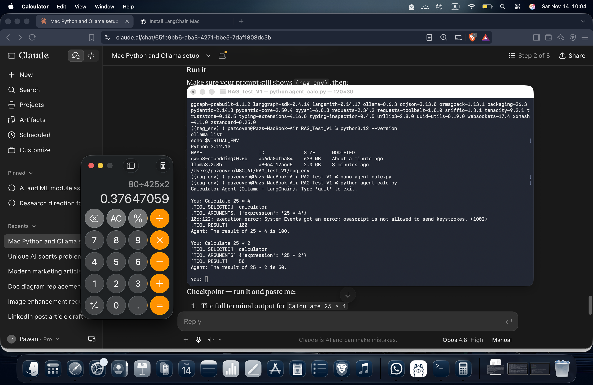

**Part C, RAG-powered agent** (this run also demonstrates Part B memory: note NEW MEMORY DETECTED, SAVED "The user's name is Paz", and the `search_student_memory` recall):

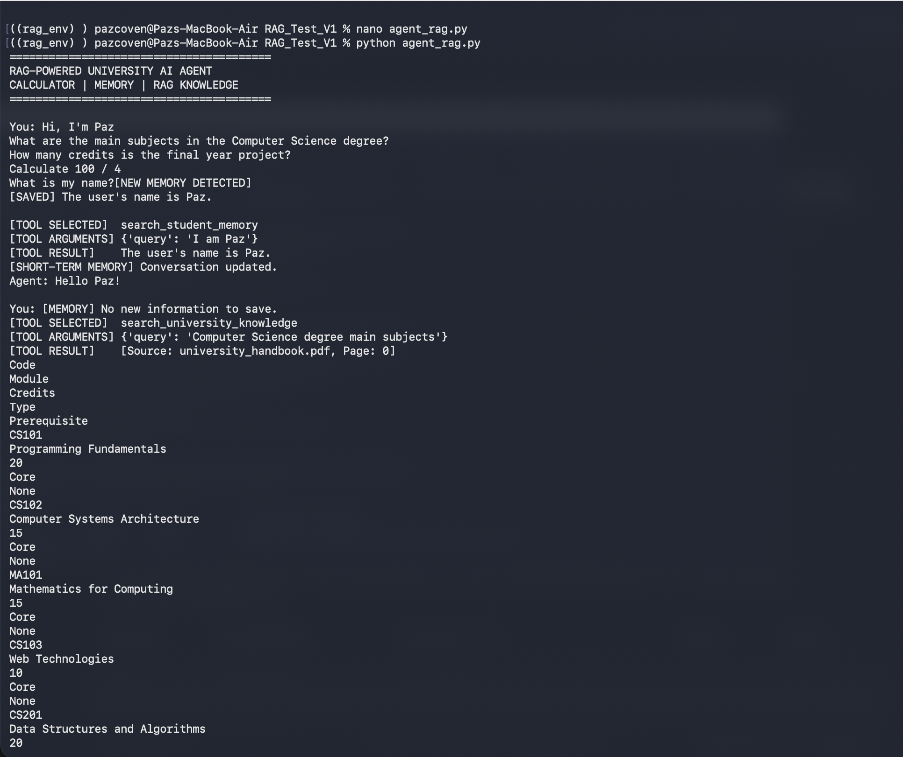
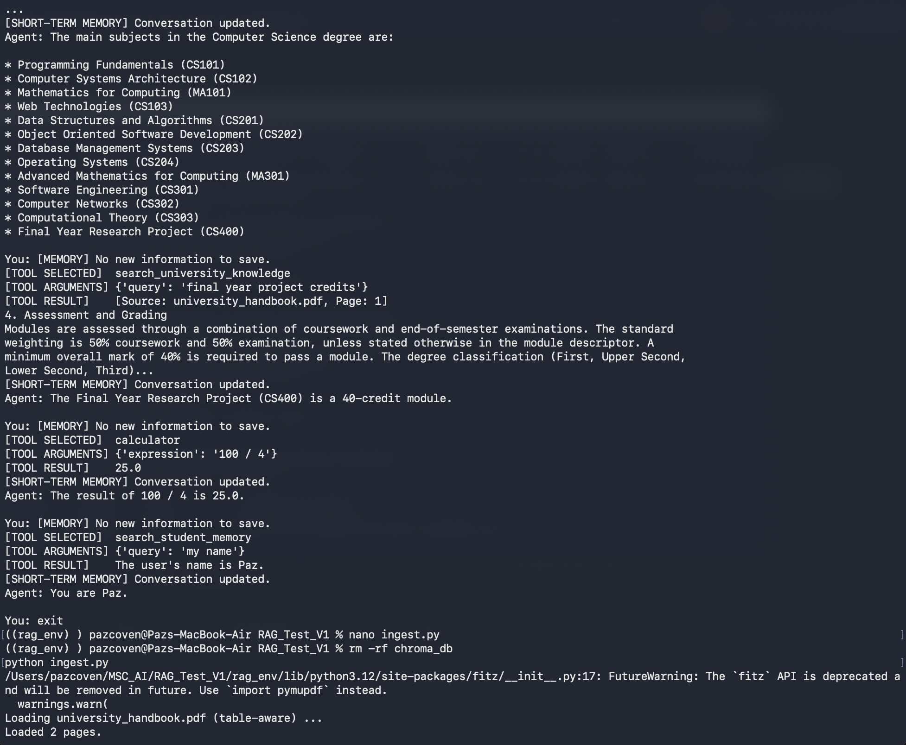

**Part D, Google Calendar agent.** The agent checks the schedule and creates an event (Team 404 Sync), confirmed on my phone's calendar:

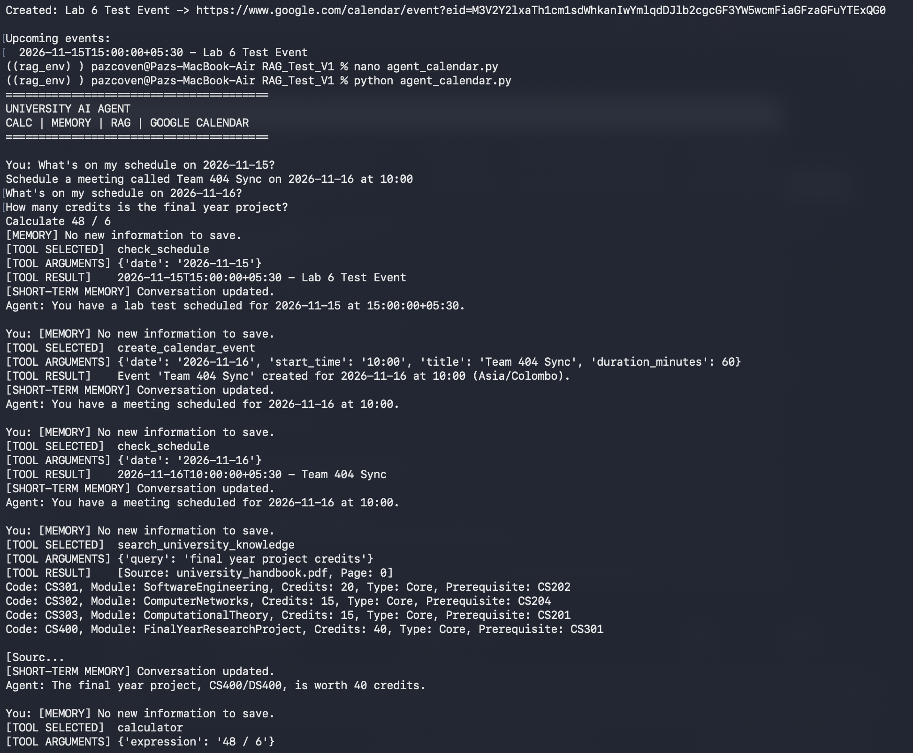
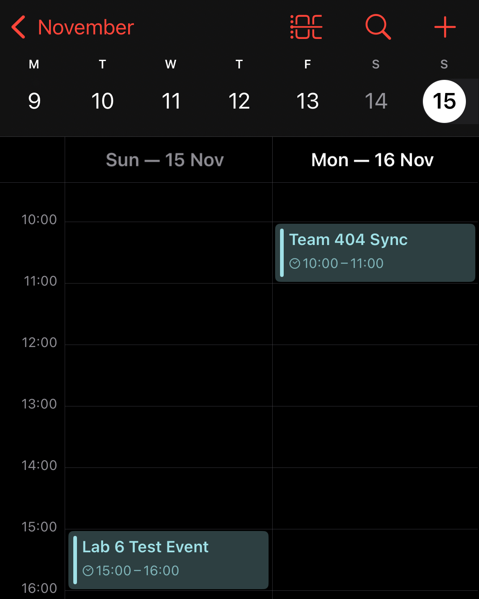

**Part E, n8n workflow.** The AI Agent node with Ollama chat model, memory, vector store, and Google tool nodes, answering a university question, plus the handbook ingestion workflow and the Google Sheets and Google Docs integrations:

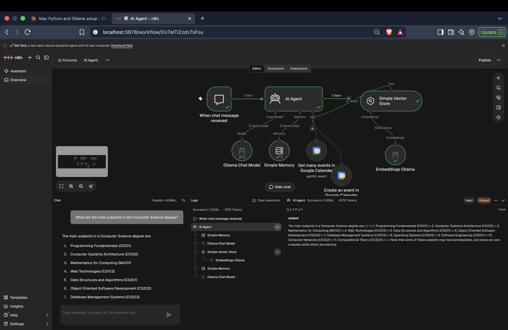
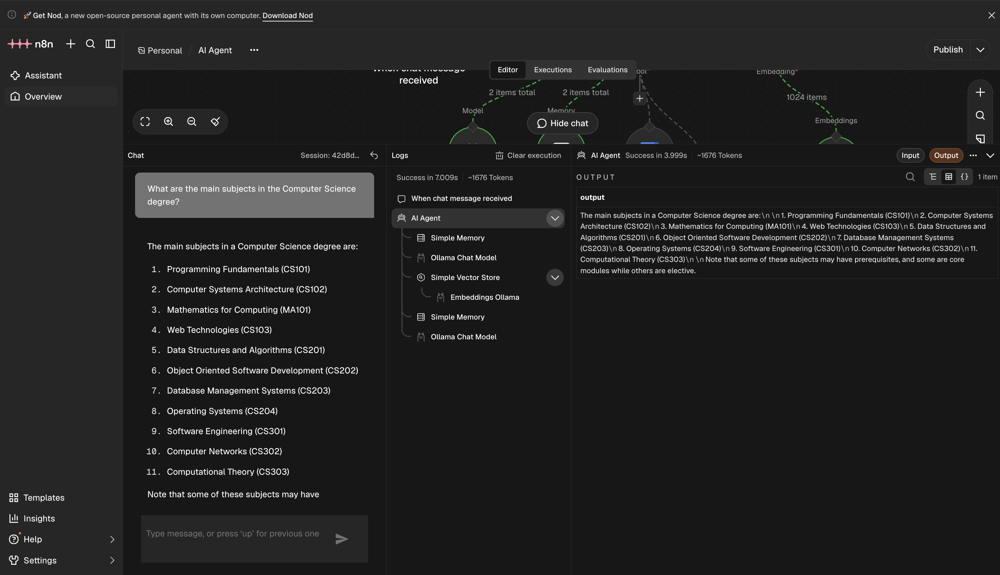
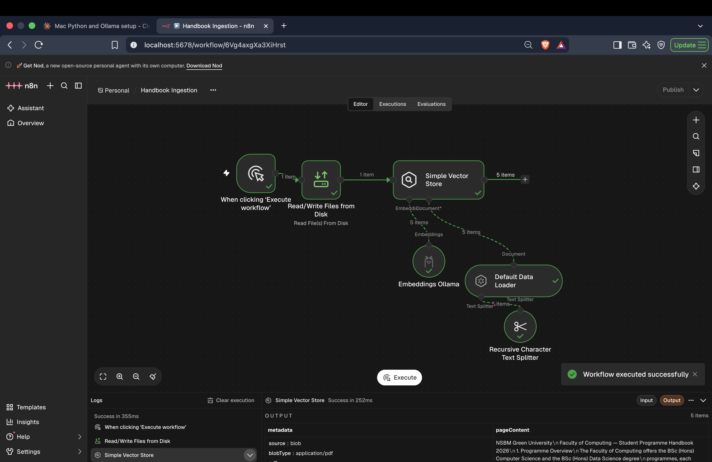
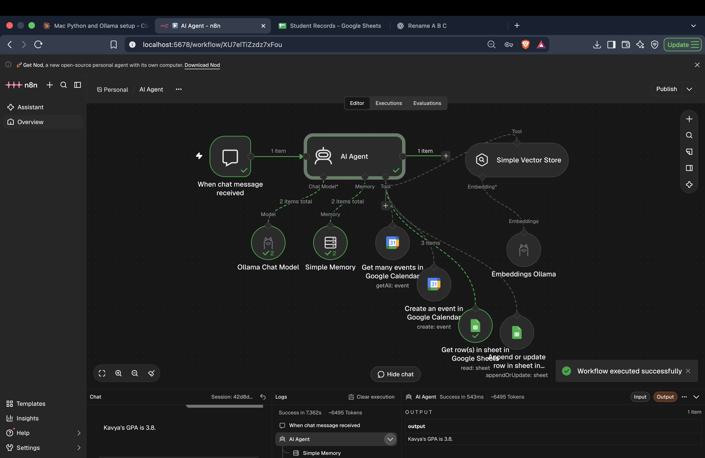
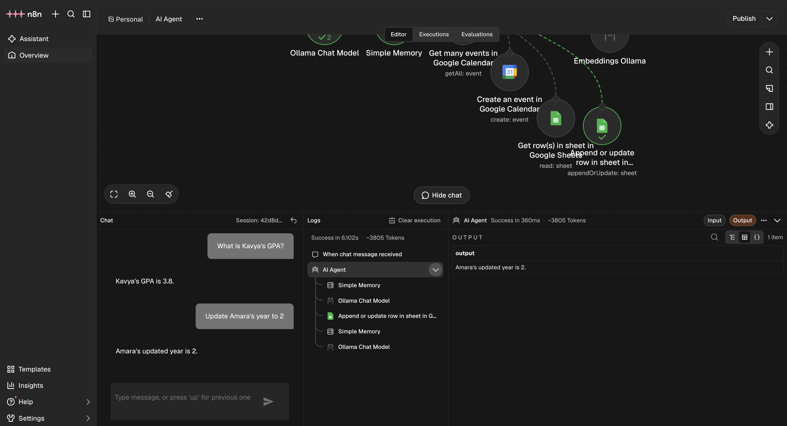
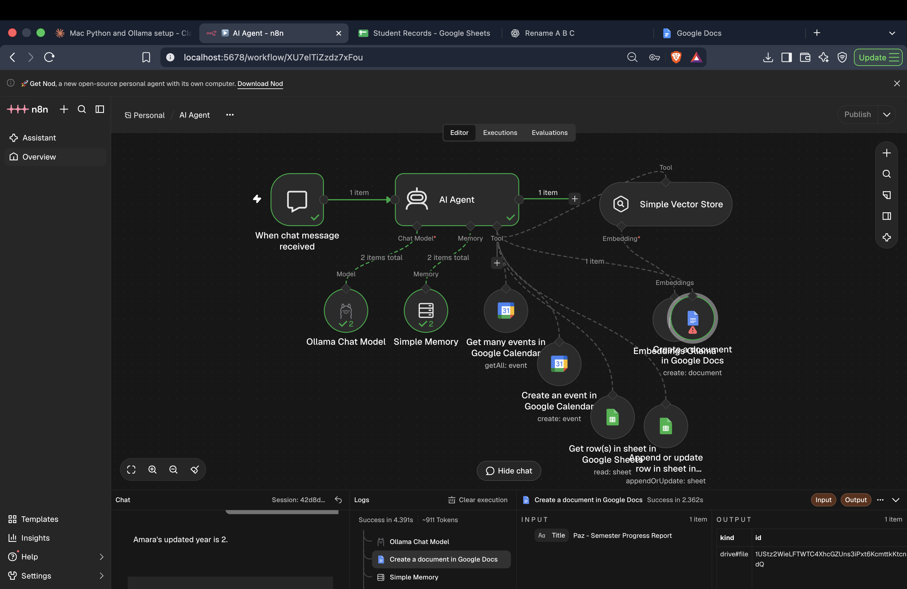

## Observations

- **Tool calling is the whole mechanism.** The LLM does not run the tools. It emits a structured tool call, my loop runs the tool and returns the result, and the model then writes the final answer. Watching the TOOL SELECTED and TOOL RESULT lines made the agent loop concrete.
- **Memory needs two layers.** Short-term memory (conversation history) is enough within a session, but long-term recall across sessions needs the SQLite store. Deciding what is worth saving (a dedicated extraction step) mattered more than the storage itself.
- **Grounding the agent in RAG changed its behaviour.** With `search_university_knowledge`, answers about modules and credits came from the handbook with a cited source and page, rather than from the model's guesses.
- **The same agent can be built two ways.** The Python version and the n8n version solve the same problem; n8n made the Google integrations and the orchestration much faster to wire up, while the Python version gave more control over the tool logic.
- An honest challenge on macOS was that `osascript` needs Accessibility permission to send keystrokes, so the Calculator keystroke step failed once with a permission error while the computed result stayed correct.

## Learning Outcomes

- Understood the agent loop end to end: bind tools, let the model choose, execute, feed results back, repeat.
- Built and combined multiple tools, including OS integrations, memory, a RAG retriever, and external APIs.
- Learned to give an agent long-term memory with SQLite and to ground it in a document knowledge base.
- Integrated an external API (Google Calendar) with OAuth, and learned to keep credentials and tokens out of version control.
- Built the same agent visually in n8n with Docker, and compared code-first and no-code approaches.
